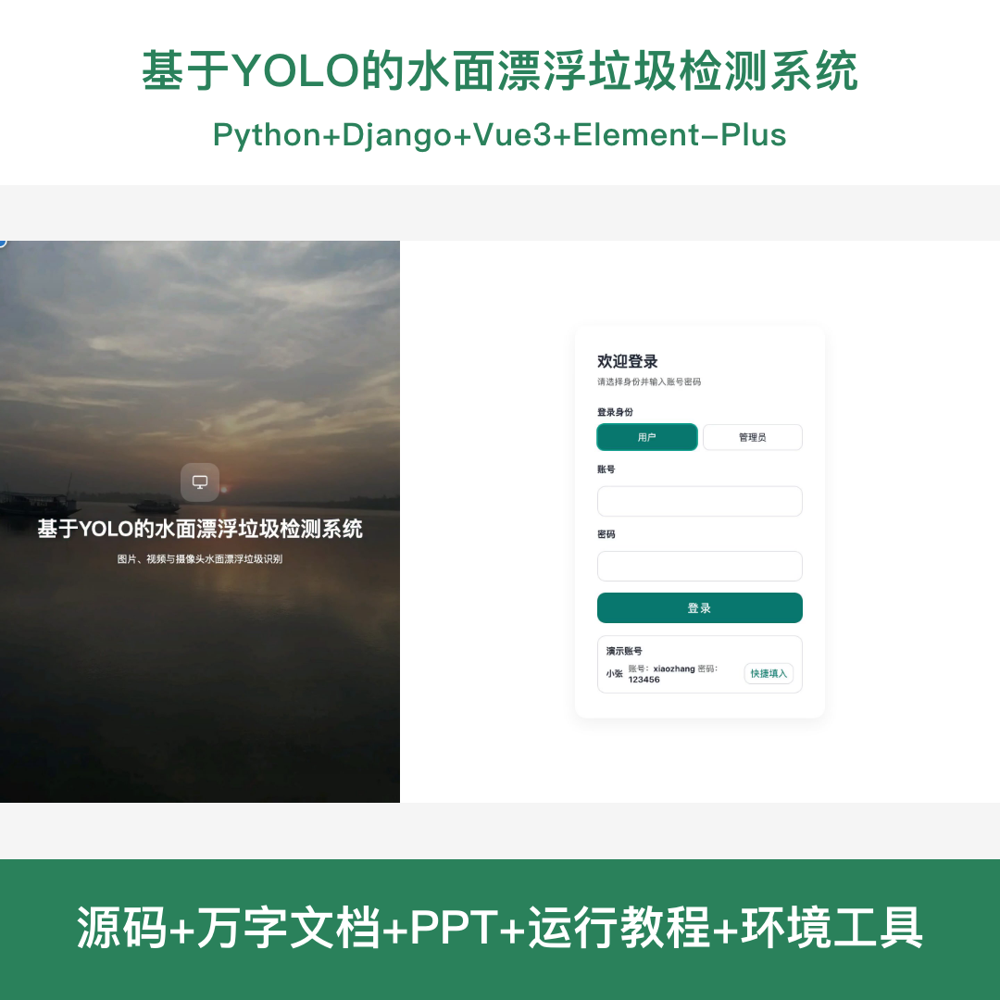
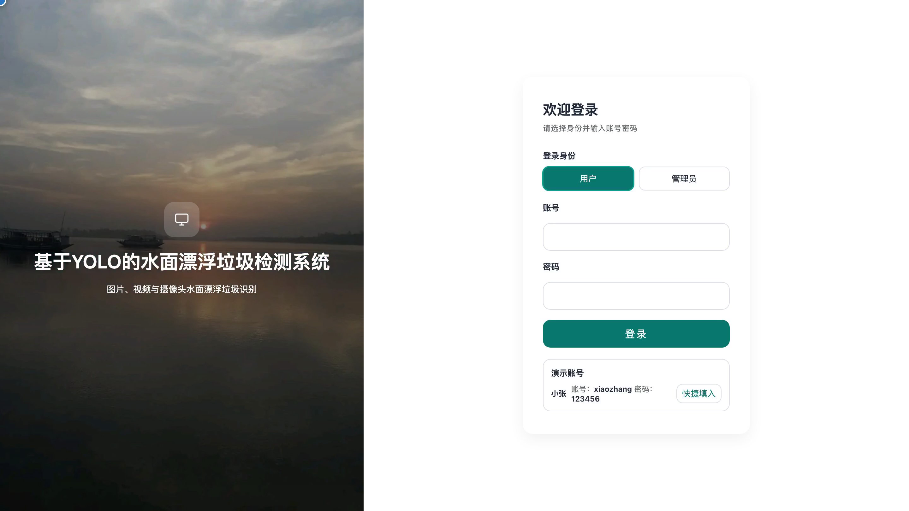
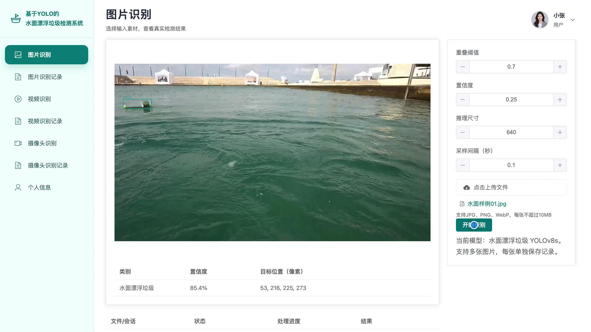
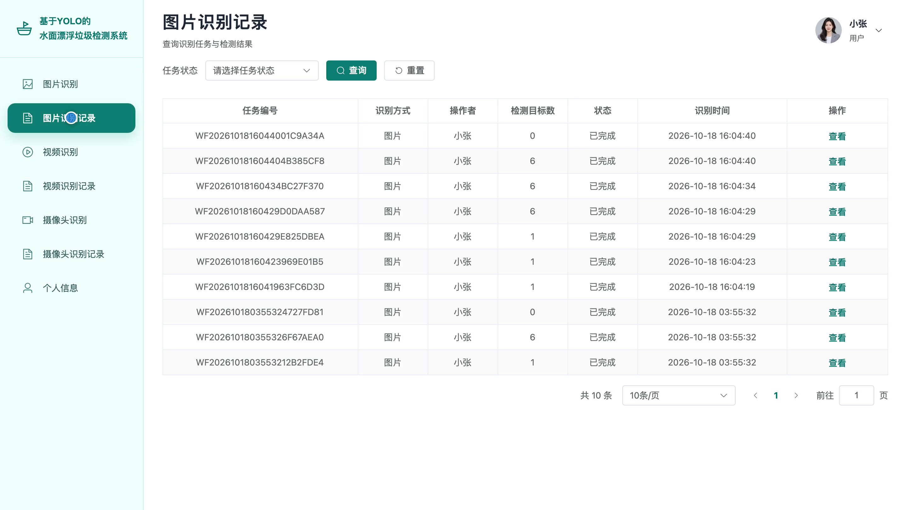
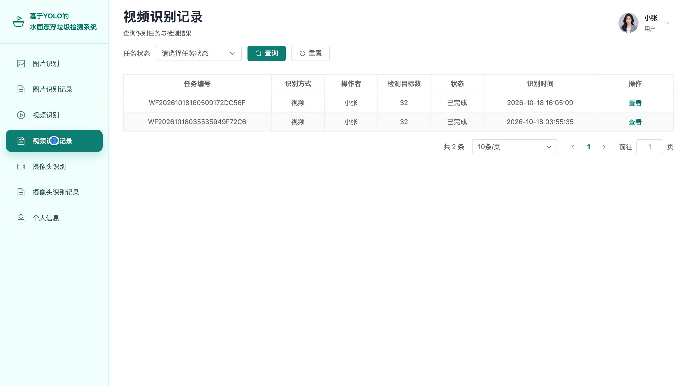
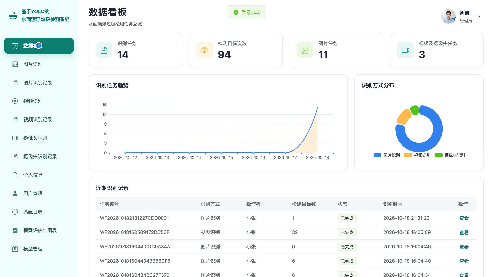
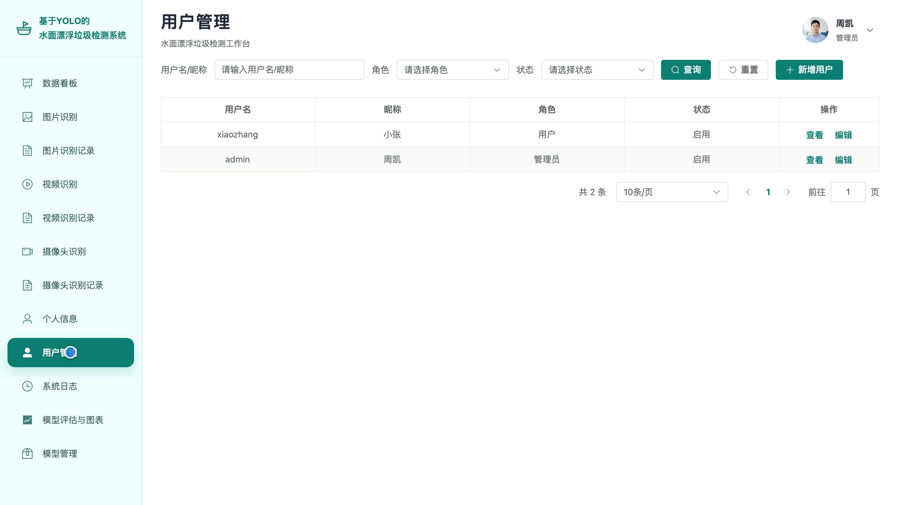
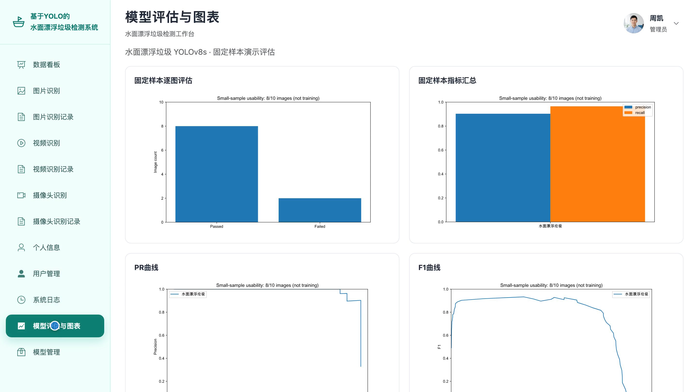
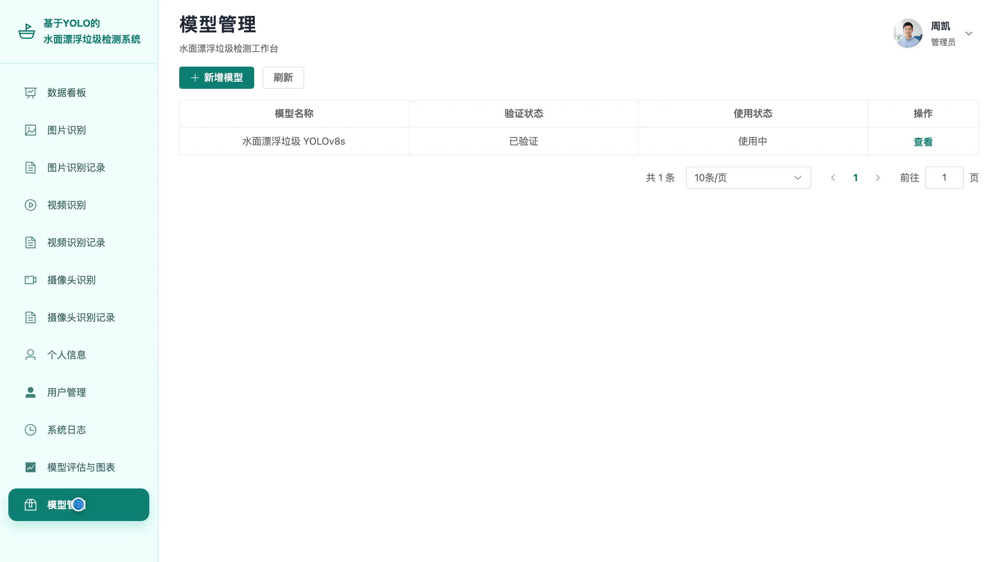

# bs179D
bs179D基于YOLO的水面漂浮垃圾检测系统源码 Python Django Vue3
## 源码问题查看主页咨询

### 一、关键词
水面漂浮垃圾检测、河道垃圾识别、水域环境监测、河湖保洁、漂浮物巡检

### 二、作品包含
源码+数据库+全套环境和工具资源+本地部署教程

### 三、项目技术
前端技术： Html、Css、Js、Vue3.4、Element-Plus
后端技术：Python、Django、DRF、Ultralytics、PyTorch、OpenCV、YOLOv8s

### 四、运行环境要求
开发工具：PyCharm + VSCODE

数据库：MySQL5.7+（共9张表）

数据库管理工具：Navicat10以上版本

环境配置软件： Python3.13.5

前端Nodejs：20.19.5

浏览器：谷歌浏览器

### 五、项目介绍
项目编号：bs179D

本系统面向河道、湖泊等水域的漂浮垃圾巡检，提供图片、视频与摄像头检测，可查看目标框、置信度和数量，保存识别记录并回看、导出检测结果。管理员可管理用户、本地模型、统计看板和评估图表，模型仅输出水面漂浮垃圾单类别，不细分垃圾材质。

角色：用户、管理员

用户功能：水面图片垃圾检测、视频与摄像头连续识别、检测参数设置、识别记录查询与详情回放、检测结果与明细导出、个人信息与密码修改。

管理员功能：水面图片及视频摄像头垃圾检测、识别记录与结果管理、检测统计看板、用户与账号权限管理、系统操作日志查看、本地模型登记验证与启用、模型评估与图表查看、个人信息与密码修改。

### 六、运行截图

